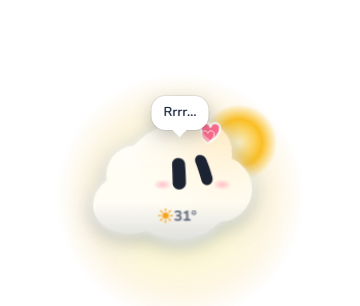
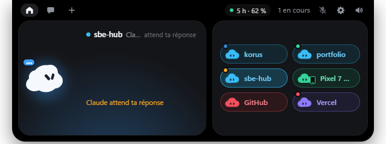
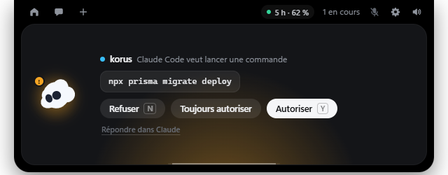
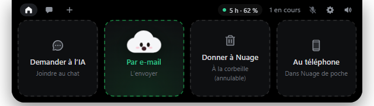

# Nuage ☁️

**Un petit compagnon de bureau pour Windows** : un nuage vivant qui flotte sur ton écran (ou dans une « encoche » en haut), réagit à ce que tu fais, discute avec l'IA de ton choix, suit tes agents de code, et se relie à ton téléphone Android.

*A cute desktop companion for Windows (Electron): a living cloud that chats with the AI of your choice (OpenRouter, OpenAI, Gemini, Claude, Ollama…), acts on your PC with your permission, watches your coding agents, and talks to an Android companion app. UI in French.*

<p align="center">
  
</p>

<p align="center">
  
  
  
</p>

## Ce qu'il sait faire

- **Il habite l'encoche du haut** (à gauche de la pilule, de la couleur du temps qu'il fait), ou flotte sur le bureau, au choix.
- **Il vit** : il suit la souris, respire, saute, s'endort quand le PC est inactif, se fâche si on le clique trop, prend la couleur de la météo de ta ville (soleil, pluie, orage, neige, nuit).
- **Chat avec n'importe quelle IA** : OpenRouter (des centaines de modèles avec une seule clé), OpenAI, Gemini, Claude (clé d'API ou abonnement), Ollama et LM Studio en local. Tes clés restent chiffrées sur ton PC.
- **L'IA agit pour toi** : lire et écrire des fichiers, lancer des commandes PowerShell, lire des pages web, utiliser des compétences. Chaque action demande ton accord (Autoriser / Refuser / Toujours).
- **Compétences et plugins** : ajoute des « skills » (SKILL.md) et des plugins depuis un lien GitHub, une archive .zip ou `/plugin install nom@catalogue`. Toutes les IA du chat s'en servent.
- **Encoche** en haut de l'écran : chat, suivi en direct de Claude Code (étapes, fichiers modifiés, autorisations, limites), intégrations (GitHub, Stripe, Vercel, Resend, Notion, n8n, Cal.com).
- **Glisser un fichier** sur l'encoche : Nuage vient l'avaler et le donne à l'IA, l'envoie par e-mail, au téléphone, ou à la corbeille (annulable).
- **Voix** : « Hey Nuage » (reconnaissance vocale de Windows, hors ligne) ; réponses lues à voix haute.
- **Musique et vidéos** : il danse au rythme, mode cinéma en plein écran.
- **Téléchargements** : il se remplit d'eau verte pendant qu'un fichier se télécharge.
- **Rappels** : pause, verre d'eau, Pomodoro, batterie faible.
- **Nuage de poche** (Android) : copier-coller et fichiers entre PC et téléphone, faire sonner le téléphone, approuver les demandes de tes agents depuis le téléphone, widget.

Le détail de chaque fonction est dans [LISEZ-MOI.md](LISEZ-MOI.md).

## Installer

Il faut **Windows 10 ou 11** et **[Node.js](https://nodejs.org) 20 ou plus**.

```bash
git clone https://github.com/<ton-pseudo>/nuage.git
cd nuage
npm install
npm start
```

Ensuite :
- **Ctrl+Alt+N** cache ou rappelle Nuage ; clic droit sur lui (ou sur son icône près de l'horloge) : le menu.
- **Roue dentée de l'encoche → Intelligence artificielle** : colle la clé de ton IA (par exemple une clé OpenRouter, sur openrouter.ai/keys), puis « Tester ».

### Facultatif

- **Voix naturelle** (au lieu de la voix de Windows) : voir [voix-naturelle/LICENCES.txt](voix-naturelle/LICENCES.txt) (Piper + voix françaises, hors ligne).
- **Pourcentage exact des téléchargements** : charger le dossier `extension-navigateur` comme extension non empaquetée dans Chrome ou Edge (mode développeur).
- **Suivi de Claude Code** : réglages → « Brancher Nuage à Claude Code » (ajoute des hooks dans `~/.claude/settings.json`, avec une sauvegarde ; « Débrancher » les retire).

## Nuage de poche (Android)

L'appli est **fournie, prête à installer** : `telephone/nuage-de-poche.apk`. Dans la barre de Nuage : **Téléphone** → **Installer l'appli**, puis vise le QR code avec l'appareil photo du téléphone ; ensuite **Associer**. Le téléphone et le PC doivent être sur le même Wi-Fi ; tout passe en local, chiffré.

Pour la reconstruire après une modification (il faut **Android Studio** : SDK Android et JDK) :

```bash
cd mobile
npm install
npm run sync
npm run apk
```

## Tests

```bash
node outils/test-actions.js
node outils/test-extensions.js
node outils/test-agents.js
node outils/test-lien.js
node outils/test-meteo.js
```

Test complet de l'interface (captures d'écran dans un dossier) : définir la variable `NUAGE_AUTOTEST_DIR` vers un dossier vide, puis `npm start`.

## Vie privée

- Tes clés d'API sont chiffrées par Windows (`safeStorage`) et ne quittent jamais ton PC, sauf vers le service que tu as choisi.
- La météo n'envoie que les coordonnées de ta ville (Open-Meteo, aviationweather.gov).
- Le lien avec le téléphone reste sur ton réseau local et il est chiffré.
- Le micro (« Hey Nuage ») est analysé sur le PC par Windows ; rien n'est enregistré.

## Licence et remerciements

- Code sous licence **[AGPL-3.0](LICENSE)**, comme le moteur d'avatar sur lequel Nuage repose.
- Avatar : [Bible Strong Avatar Lab](https://github.com/smontlouis/bible-strong-avatar-lab) de Stéphane Montlouis-Calixte (AGPL-3.0).
- Icônes : [Phosphor Icons](https://phosphoricons.com) (MIT, voir `renderer/icones-LICENCE.txt`).
- Polices : Nunito et JetBrains Mono (SIL Open Font License, fichiers inclus).
- Mise en page de l'encoche inspirée de [Coucou](https://github.com/Louis-CFM/coucou) (code MIT) ; aucun dessin, son ni nom de Coucou n'est repris : Nuage est un personnage original.

Les contributions sont les bienvenues : ouvre une *issue* ou une *pull request*.
